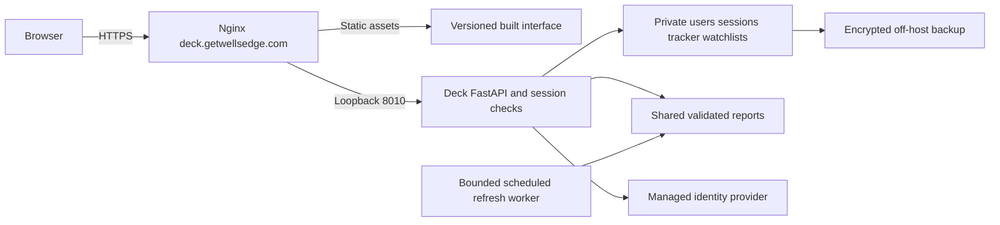

# Deck deployment audit and launch plan

**Superseded:** the user chose standalone Windows, macOS, and Linux apps with
automatic updates. Source remains under `timcocuzza`. Use the current
[desktop release plan](desktop.md). The following records the earlier hosted
proposal and its findings; no Vegas deployment or ownership transfer is planned.

Audit date: October 16, 2026. Target: **https://deck.getwellsedge.com** on Vegas EC2. Product requirement: public registration, separate accounts, and administrator approval before access.

**Launch decision: do not expose the current application publicly.** Its research interface is well developed, but authentication, approval, and ownership checks do not exist. Anyone reaching the API can read all tracker records and watchlists; a non-browser client can change them. Hosting behind HTTPS alone does not fix that. Vegas also needs more memory headroom and Deck needs shared report computation before public use.

This plan keeps React, FastAPI, the dark Inter interface, navigation, charts, saved drafts, and source provenance. It adds the account and operating boundaries required for a hosted product. No production services, DNS records, AWS resources, repository ownership, or remote repository settings were changed during this audit.

## Completed preparation

- Replaced the K mark with the supplied Deck wordmark, updated page/API/install branding and tracker download names, and generated favicon and app icons from the supplied mark. The displayed wordmark is approximately 8 KB WebP instead of the 524 KB original PNG. Original artwork remains in `public/icons`.
- Updated the recovery page for hosted use while retaining local startup help. The worker still caches only recovery HTML, never records or market data, and cleans up the old branded caches.
- Kept the existing local database filename to preserve records. New tracker exports use `deck-tracker`; older `kalshi-deck-tracker` backups remain importable.
- Added `DECK_DATABASE_PATH` for persistent storage outside release directories and `DECK_PUBLIC_ORIGIN` for an exact HTTPS write origin. All API mutations, including source refreshes, now receive the origin check. Hosted writes with missing or foreign origins are rejected. This is CSRF groundwork, **not authentication**.
- Added `Cache-Control: no-store` and `X-Content-Type-Options: nosniff` to API responses.
- Added hash verification to the existing Python dependency pins, `.github/workflows/ci.yml`, Dependabot configuration, bundle budgets, and release packaging that excludes local databases and credentials.
- Ignored the untracked `.aws` placeholder and private key extensions. No credential contents were read or printed.

## Findings and release priorities

| Priority | Finding and evidence | Required treatment |
| --- | --- | --- |
| Critical | No authentication or approval dependency in `backend/app.py`; tracker report/export and watchlist reads are open, and writes have no user identity. | Require a valid session and approved account on every protected API. Admin-only approval and refresh operations. |
| Critical | `tracker_settings` is a singleton, tickets have no owner, and `watchlist` uses ticker as its global primary key (`backend/tracker.py`, `backend/watchlist.py`). | Migrate to per-user settings, tickets, and bookmarks. Scope every list, lookup, update, delete, import and export to the authenticated user. Assign existing records to the initial admin explicitly. |
| High | Browser opens trigger 23 source refreshes. Anonymous refresh/history endpoints can consume upstream requests, CPU and memory (`src/main.tsx`, `backend/catalog.py`, `backend/app.py`). | Central refresh scheduler, shared freshness policy, bounded queue, administrator refresh privilege, per-user/IP limits. Ordinary reads must not initiate full refreshes. |
| High | Source download uses unbounded `response.read()`, compressed CSV expands fully, and pagination has no total page/row budget (`backend/sources/common.py`, `nflverse.py`, `kalshi.py`). History accepts arbitrarily wide windows. | Cap compressed and expanded bytes, rows/pages, allowed historical seasons, history duration and interval combinations; stream CSV; add aggregate deadlines, cancellation and backoff. Never replace the last good snapshot on failure. |
| High | Ranked reports repeatedly decompress huge snapshots and recalculate results; props/player logs calculate multiple reports per request. Approximately 500 MiB peak process RSS in the local partial-season benchmark. | Project source columns, compute shared reports once per snapshot revision, bound memory and concurrent work, and separate refresh from serving. |
| High | No automated full backup/restore. Tracker JSON excludes watchlists and source snapshots. | Encrypted full database backups, pre-migration backup, off-host retention and a tested restore procedure. Back up account/session state once introduced. |
| High | No secure public deployment pipeline, isolated service or deployment health gate existed. The adjacent Wells workflow fetches moving `main`, learns SSH host keys during the run and modifies an installation in place. | Use exact tested artifacts, restricted deployment identity, independent Deck service, protected environment, atomic release activation and rollback. Do not copy those adjacent workflow patterns. |
| Medium | HTTPS writes were previously limited to localhost; refresh had no origin check. | Fixed groundwork in this change. Add session-bound CSRF protection, trusted Host validation, proxy trust and negative integration tests with authentication. |
| Medium | Browser HTTP caches were not uniformly disabled for API data. Frontend report caches are module-scoped and assume one user. | API no-store added. Clear all client state and caches at logout/account switch; never key private data only by URL in a multi-user session. |
| Medium | No request-body ceiling before JSON parsing; tracker checks backup size after parsing. No pagination for large tracker/watchlist lists. | Enforce an edge and ASGI byte limit, per-user quotas, bounded import size/count, and pagination before opening public registration. |
| Medium | Production security headers and Host allowlist absent; debug OpenAPI routes are exposed. | Nginx CSP, frame protection, HTTPS/HSTS, explicit hosts and safe forwarded headers; protect or disable API docs. |
| Medium | Pending users, approval/rejection, account disablement, recovery, logout, session revocation and audit records do not exist. | Implement account lifecycle below; test immediate revocation and administrator authorization. |
| Product | Season defaults to calendar year; weekly games accept weeks 1–18 and most stats are regular-season only. January/February and postseason behavior remain unresolved. | Define NFL season rollover and clearly label postseason availability; do not silently present a new empty season in January. |
| Product | Quote/history freshness depends on opening/manual refresh. Partial ticket sales and additional prop types remain unsupported. | Publish freshness policy and preserve age/error notices. Keep current tracker scope explicit; partial sales and expanded props need not block a scoped beta. |
| Product | Public redistribution permissions are not documented for all external feeds, scraped pages and team imagery. | Complete a source/license inventory before public release. Distinguish open-source code licenses from data and image rights. |

Existing strengths: parameterized SQLite statements, React text escaping, validated market identifiers with fixed upstream endpoints, allowlisted team image URLs, explicit missing-data handling, exact monetary arithmetic, optimistic edit conflicts, atomic backup imports, and retention of last-good source snapshots. These reduce several common risks but do not substitute for account isolation.

nflverse explicitly distinguishes package licensing from underlying data ownership. Review each provider, especially the scraped Sharp/NFL pages, FTN attribution, Kalshi API terms and team imagery, against the intended public use. This audit does not establish redistribution permission. [nflverse data notice](https://nflverse.nflverse.com/index.html), [Kalshi developer agreement](https://kalshi-public-docs.s3.amazonaws.com/Kalshi-Developer-Agreement.pdf).

## Account and approval design

Use a managed identity provider, with **Amazon Cognito as the proposed AWS-native choice**, and keep approval and authorization inside Deck. Provider selection and pricing must be confirmed before provisioning. Cognito's authorization-code flow supports PKCE; use a maintained OIDC client, state and nonce validation, exact callback URLs, and server-side token exchange. Keep identity tokens out of browser local storage. [Cognito authorization endpoint](https://docs.aws.amazon.com/cognito/latest/developerguide/authorization-endpoint.html).

Flow: register and verify email → sign in → pending approval screen → administrator approves → research access. Signing in successfully must never imply approval. Rejected or disabled accounts cannot read research, personal records, exports, or admin APIs. Registration and recovery responses should not reveal whether an account exists. Registration, callback, login and recovery need independent abuse limits.

Use a host-only `__Host-deck_session` cookie: Secure, HttpOnly, SameSite=Lax, Path=/, no Domain attribute. It contains a random opaque session identifier; store its digest and expiry server-side. Start with 30-minute inactivity and 12-hour absolute expiry, subject to product review. Rotate on authentication, revoke on logout/disable/security changes, and check current account status on protected requests. Include a session-bound CSRF token on mutations as well as the exact-origin check. [OWASP session guidance](https://cheatsheetseries.owasp.org/cheatsheets/Session_Management_Cheat_Sheet.html).

The admin interface needs pending/approved/disabled filters, approve/reject/disable actions, timestamps and an audit trail. Require MFA for administrators and recent authentication for role changes; enforce the MFA requirement server-side with the provider integration. Bootstrap the first admin through a controlled command using a known provider subject, never by making the first registrant an admin. Block accidental removal of the last active admin. Account management does not automatically grant access to other users' private notes or tickets. [Cognito MFA](https://docs.aws.amazon.com/cognito/latest/developerguide/user-pool-settings-mfa.html).

Proposed storage changes:

| Record | Ownership and constraints |
| --- | --- |
| `users` | Internal UUID, unique provider subject, verified email, role, approval status, timestamps, approver and authorization version. Email alone is not a stable identity. |
| `sessions` | Hashed opaque ID, user foreign key, creation/last use/absolute expiry and revocation metadata. |
| `tracker_settings` | One row per `user_id`, replacing the singleton. |
| `tracker_tickets` | Mandatory `user_id`; all SQL predicates include it. Import assigns the current owner server-side and cannot overwrite another user's UUID. |
| `watchlist` | Composite identity `(user_id, ticker)`; notes and revisions belong to that user. |
| `admin_audit` | Actor, target, action, timestamp and request identifier; no tokens or private record contents. |
| Source snapshots/reports | Shared validated research data, separate from private records; shared cache keys include source revision and season. |

Use versioned additive migrations and a migration ledger. Retain SQLite for a measured, single-instance approved-user beta, enable foreign keys on every connection, use WAL and a busy timeout, and keep write transactions short. Never put the SQLite files on a network filesystem. Move to a dedicated relational database when measured write contention or multi-instance deployment requires it, rather than adding another database daemon to Vegas immediately. [SQLite WAL guidance](https://www.sqlite.org/wal.html).

Authorization acceptance tests must include anonymous, pending, rejected, disabled, approved A, approved B and admin. Attempt foreign identifiers through every list/detail/write/export/import route; check B cannot see A's cached frontend state after an account switch. Check revoked sessions immediately fail. Treat absence of a policy as denial, including future routes. [OWASP authorization guidance](https://cheatsheetseries.owasp.org/cheatsheets/Authorization_Cheat_Sheet.html).

## Vegas capacity and infrastructure evidence

Read-only SSH inspection at approximately 17:49–17:51 UTC on October 16:

| Resource | Observed |
| --- | --- |
| OS and architecture | Ubuntu 26.04 LTS, x86_64 |
| EC2 type and region | t3.medium, us-east-1 (read through IMDSv2; no IAM credentials retrieved) |
| CPU | 2 logical CPUs; load average 0.11 / 0.05 / 0.02 at inspection |
| Memory | 3,831 MiB total; 2,416 MiB used; 1,415 MiB available |
| Swap | None |
| Root disk | 248 GiB total, 242 GiB available |
| Runtime | Python 3.14.4; Nginx 1.28.3 |
| Existing services | Wells FastAPI on loopback port 8000; MySQL on loopback 3306; several additional Node/Python applications |
| Deployment/operations | Snap SSM agent active; certificate renewal timer present; CloudWatch agent service inactive/not present |
| Network | SSH and Nginx bind publicly; app/database ports observed bind to loopback; UFW inactive |
| Deck routing | No Deck Nginx virtual host found; Deck DNS lookup returned no IPv4 result on Vegas |

UFW being inactive does **not** prove public exposure: EC2 security groups were not available through the authenticated tooling. Before launch, verify security-group ingress, instance profile scope, EBS encryption, CPU-credit mode, Elastic IP, backup policies and CloudWatch alarms in AWS. An active SSM process alone does not prove IAM permissions or managed-node connectivity.

**Capacity recommendation:** do not add the current unrestricted Deck workload to the current 4 GB shared host. For the requested shared-Vegas launch, provision at least **8 GiB total RAM** (a compatible `t3.large` is the direct same-family option), keep one Deck web worker initially, and apply the optimizations below. Consider `t3.xlarge` (4 vCPU/16 GiB) or a non-burstable instance if concurrency testing shows CPU pressure; a dedicated Deck host is the isolation alternative. This is a sizing recommendation, not a proven load capacity or a purchased upgrade. Keep at least 2 GiB system headroom under the agreed peak workload after all existing apps are included.

Starting resource budgets to validate after optimization: web `MemoryHigh=768M`, `MemoryMax=1G`; one refresh worker `MemoryHigh=1G`, `MemoryMax=1536M`, low CPU weight and a one-core ceiling. Reject or queue excess work; never let unlimited request threads each decode a season. A 1–2 GiB swap file can soften exceptional spikes but is not a replacement for RAM. Do not enable it or resize during normal traffic without a maintenance plan.

Resizing an EBS-backed EC2 instance requires stopping it and affects every site on Vegas. Snapshot first, confirm compatible architecture and Elastic IP/DNS, record services, resize in a maintenance window, then verify all sites and timers. A non-Elastic public IPv4 address can change after a stop/start. No resize was performed. [AWS instance resize procedure](https://docs.aws.amazon.com/AWSEC2/latest/UserGuide/change-instance-type-of-ebs-backed-instance.html).

Install/configure memory and disk telemetry plus app latency/errors, OOM/service restarts, upstream failures, stale snapshots, backup age, certificate expiry and CPU credits if applicable. Initial alarms: available RAM below 20% for five minutes, disk above 80%, sustained CPU above 70%, API errors above 1%, failed backups, and source freshness beyond its policy. Tune from a 24-hour baseline and a game-day load test. Memory/disk metrics require guest-level collection such as the CloudWatch agent. [CloudWatch agent metrics](https://docs.aws.amazon.com/AmazonCloudWatch/latest/monitoring/metrics-collected-by-CloudWatch-agent.html).

## Performance without changing the interface

Measured on the development machine against saved 2026 partial-season snapshots, without upstream requests. These are individual sequential calls, not production latency or p95 estimates. RSS is the cumulative high-water mark of the same process.

| Operation | Time | Peak RSS | Uncompressed JSON response |
| --- | ---: | ---: | ---: |
| Week 6 matchups | 0.041 s | 55.1 MiB | 750,225 bytes |
| Rankings | 1.975 s | 467.7 MiB | 965,139 bytes |
| Position defense | 2.030 s | 499.6 MiB | 987,966 bytes |
| Elo | 0.187 s | 499.6 MiB | 274,538 bytes |

The 18 MB SQLite database hides substantial expanded data: 14,031 play-by-play rows occupy **138.58 MB JSON** from an 8.12 MB compressed payload. Player stats expand to 17.89 MB; FTN to 9.33 MB. Full-season and concurrent behavior remain to be measured. Adding Uvicorn workers multiplies process memory and does not fix repeated computation. [FastAPI deployment concepts](https://fastapi.tiangolo.com/deployment/concepts/).

Prioritized changes:

1. **Reduce work and memory before adding workers.** Retain required source columns plus explicitly used optional fields such as lateral-rusher identity; stream decompression/CSV parsing within limits. Compare all report outputs against existing fixtures and saved real-data reports before discarding fields.
2. **Materialize shared reports on refresh.** Calculate rankings, position defense and Elo once for a coherent source revision. Publish atomically only after validation; keep previous reports during refresh failures. Deduplicate simultaneous rebuilds, bound cache sizes, and expose source timestamps/errors. Cache only shared research, not user data.
3. **Separate source refresh from page opening.** Start with market refreshes every 2–5 minutes during active windows, stats hourly during games or after provider updates, and daily otherwise; confirm quotas and provider cadence before scheduling. These are proposed freshness targets, not claims of live quotes. Opening a page reads saved reports immediately; admin refresh enters a shared bounded queue.
4. **Trim responses.** Home cards need concise summaries; fetch full logs, settlement detail and deep research when opened. Preserve fast Back navigation, selected thresholds, saved drafts, and last-good content. Batch/deduplicate price history with a short server TTL and an explicit seven-day maximum for the current UI.
5. **Compress and cache correctly.** Gzip JSON/CSS/JS at Nginx; Brotli is optional after module verification. Cache content-hashed `/assets/` for a year with `immutable`; revalidate HTML, manifest and worker scripts. Give non-fingerprinted icons short/revalidating cache policies. Never edge-cache private API responses. Compression is not a license to cache authenticated data publicly.
6. **Keep the visual design.** Use the same dark surfaces, Inter font, team accents, compact cards and reduced-motion behavior. Add account controls unobtrusively; approval/login screens should use the same components. Consider lazy-loading tracker/admin/report panels only if measurements justify it, preserving mounted drafts when switching tabs.

Current build: approximately 94.4 KB gzip JavaScript and 6.1 KB gzip CSS. CI now caps total built JS at 120,000 gzip bytes and CSS at 12,000 bytes. Load targets for the optimized beta: cached research API p95 below 300 ms, private writes below 500 ms, LCP below 2.5 s on representative mobile service, no stale-user data, and at least 2 GiB available host RAM during 20 concurrent approved-user sessions plus one source refresh. These are acceptance targets to test, not achieved results.

## Deployment architecture



Use a dedicated `deck` Unix account with no login shell and no sudo, separate from `getwellsedge`. Persistent state belongs under `/var/lib/deck/`; configuration under `/etc/deck/`; releases under `/opt/deck/releases/<commit>/`; `/opt/deck/current` points to the active release. The service account must not be able to modify code, release links, Nginx files or deployment tooling. Use restrictive directory/file modes for private state and secrets.

Run one Uvicorn worker on **127.0.0.1:8010**, leaving Wells's 8000 service alone. Configure systemd restart-on-failure, graceful stop deadlines, `NoNewPrivileges`, `PrivateTmp`, `ProtectSystem=strict`, `ProtectHome`, and explicit writable state paths. Apply resource limits only after real-data full-season testing. Build frontend assets on GitHub-hosted runners; no Node runtime or npm build is needed on Vegas.

Configure a new exact-host Nginx site, leaving all existing virtual hosts unchanged. Set `DECK_PUBLIC_ORIGIN=https://deck.getwellsedge.com` and `DECK_DATABASE_PATH=/var/lib/deck/deck.sqlite3`. Enforce a 10 MiB import body ceiling before parsing, smaller normal mutation limits, bounded concurrency/timeouts and route-specific auth/refresh limits. Trust forwarded headers only from loopback Nginx; never trust arbitrary client-supplied forwarding headers. Validate application Host headers explicitly. Health/readiness must distinguish a running process from a valid schema and usable reports.

Start CSP in report-only mode in staging: scripts/connect/font from self; images from self and the exact Kalshi image host; no objects; no frames/ancestors; base/form restricted to self with explicit identity-flow exceptions if needed. Existing dynamic React styles and offline inline CSS need compatible style policy or refactoring before enforcing it. Add nosniff, frame restrictions, Referrer-Policy and a minimal Permissions-Policy. Enable HSTS only after HTTPS and renewal pass; do not casually add parent-wide `includeSubDomains` or preload directives.

DNS/TLS sequence after security and capacity gates pass:

1. Confirm the authoritative DNS provider and Vegas's stable public endpoint. Add `deck` as an A record to its Elastic IP, or CNAME to a deliberately managed stable hostname. Initially use a 300-second TTL. Add AAAA only after IPv6 routing is verified.
2. Stage the Nginx vhost with a maintenance response and ACME challenge handling. Obtain a certificate for **deck.getwellsedge.com**; the existing apex certificate may not cover it.
3. Validate Nginx configuration and certificate renewal, redirect HTTP to HTTPS, then route to the authenticated Deck service after smoke tests. Keep any staging environment private with synthetic accounts and data.
4. Verify external TLS, hostname, response headers, unauthenticated denial, approval gates, cross-user isolation, app installation, and existing Wells sites after activation. Raise TTL after stability is established.

## GitHub ownership and CI/CD

A transfer is **not technically required** to serve the subdomain. It is recommended for consistent Wells ownership and deployment policy. Current origin is `git@github.com:timcocuzza/kal-deck.git`; proposed destination is `wellstechadvisorsllc/deck`.

When the implementation is ready for the organizational transition: open the personal repository's **Settings → General → Danger Zone → Transfer**, choose `wellstechadvisorsllc`, and rename to `deck` during transfer if your organization permissions allow it. Confirm the destination name is free and your account can create repositories there. Then update the clone:

```bash
git remote set-url origin git@github.com:wellstechadvisorsllc/deck.git
```

GitHub transfers history, issues and PRs, and keeps associated secrets, webhooks and deploy keys. Review these retained credentials and the destination organization's default permissions; do not assume a transfer resets access. Recheck branch rules, Actions policy, environment protection, package permissions and plan-dependent features. Update external OIDC trust after the move. Do not recreate the old repository path, which would break redirects. [GitHub transfer instructions](https://docs.github.com/en/repositories/creating-and-managing-repositories/transferring-a-repository).

### CI provided in this change

`.github/workflows/ci.yml` runs on PRs, main pushes, manual requests and weekly schedules. It installs locked dependencies, checks types, tests Python/frontend behavior, builds assets, enforces bundle budgets, scans Git history for secrets and audits dependencies. High/critical npm findings and any Python vulnerability fail the run. Main push/manual runs package the checked-out revision and store a 14-day release candidate; PR and scheduled runs cannot produce deploy candidates.

It uses read-only repository permissions, full commit SHA pins, a checksum-pinned Gitleaks scanner, no persisted checkout credentials, no production secrets, timeouts and cancellation of superseded verification runs. Dependabot covers npm, pip and actions. It uses Python 3.14.7 and Node 24; align the Deck service's isolated Python runtime before launch rather than upgrading the shared system Python blindly. The adjacent server currently has Python 3.14.4. GitHub Actions execution and organizational feature availability remain unverified because this session has no authenticated GitHub CLI.

The committed workflow **does not deploy**. Authentication, migrations and release scripts do not yet exist, so attaching a production deployment job now would expose an unsafe app. The candidate manifest explicitly records that limitation. GitHub recommends minimal permissions, pinned actions and protected deployment secrets. [GitHub Actions secure use](https://docs.github.com/en/actions/reference/security/secure-use).

### Production delivery to implement after the launch gates

Use a protected `production` GitHub environment, main-only deployment eligibility, required reviewer where the repository plan supports it, and `concurrency: deck-production` with cancellation disabled. Initially deploy by manual dispatch selecting a successful main CI run. Later, enable automatic staging on merge and promote the same artifact to production after review. Never build again from moving `main` during deployment.

Prefer **GitHub OIDC → scoped AWS role → private S3 release object → restricted SSM deployment document**. SSM is already running on Vegas; IAM connectivity remains to be checked. Give only the deployment job `id-token: write`. Match `aud=sts.amazonaws.com` and the exact production environment subject for the transferred repository. GitHub's current subject format may include immutable organization/repository IDs; inspect the actual format and use exact conditions, not `repo:wellstechadvisorsllc/*`. Restrict the environment to main because an environment subject alone does not constrain branch. [GitHub AWS OIDC guide](https://docs.github.com/en/actions/how-tos/secure-your-work/security-harden-deployments/oidc-in-aws).

The role may upload only Deck release objects, invoke only a root-owned Deck SSM document on the intended instance/tag, and read that command's status. Do not grant generic `AWS-RunShellScript` access or broad EC2/IAM permissions. Validate a 40-character revision, artifact digest and allowlisted S3 key; use fixed command parameters, never arbitrary shell supplied by a branch. The EC2 instance role can read only Deck releases/configuration and write required backup/telemetry prefixes. AWS execution documents and command permissions must be reviewed together. [SSM SendCommand](https://docs.aws.amazon.com/systems-manager/latest/APIReference/API_SendCommand.html).

Production variables: AWS region, deploy role ARN, EC2 instance ID, private artifact bucket/prefix and SSM document name/version. Keep identity-provider client secrets and session configuration in an approved secret store or root-readable environment file on the host, never `VITE_*`, built JS, repository files or action logs. Avoid long-lived AWS access keys and copying the current broadly privileged Ubuntu SSH deployment key. If SSH is necessary temporarily, use a dedicated restricted deploy account, a host key verified out of band, and a root-owned fixed deployment command.

Deployment transaction:

1. Verify CI run repository, event, successful checks and exact main commit; download its artifact, validate digest/provenance and record the candidate manifest. A checksum alone is not proof of trusted origin.
2. On Vegas, acquire a deployment lock, check disk and memory headroom, fetch the immutable artifact and unpack into a new release directory with safe paths and ownership. Install hash-locked Python wheels into that release's venv; prepare a compatible wheelhouse in CI to avoid compiling on the host.
3. Create and validate a full online database backup. Run reviewed additive migrations once. Never reuse the local `.data` directory as release contents, replace the live DB wholesale, or restore sample data.
4. Check the candidate on a private alternate port with synthetic/account test probes. Atomically switch `current`, restart Deck, then check loopback readiness and external HTTPS/authentication behavior. Avoid overlapping writes during incompatible schema transitions.
5. On failure, switch back to the prior compatible code release and restart. Rollback must preserve new user writes; never blindly restore an old database. Breaking migrations require an explicit maintenance/recovery procedure.
6. Keep at least three recent compatible releases, record actor/revision/result, and clean up only after success. Never restart unrelated services or run OS upgrades in a routine app deployment.

## Backups and operational acceptance

Use SQLite's online backup API (or a properly quiesced snapshot), validate `PRAGMA integrity_check` on the backup, then encrypt and upload it off-host. Copying only a live database file can miss active WAL state. Initial policy: hourly backup of private account/tracker data, daily full research backup, 7 daily/4 weekly copies, plus pre-deployment backups; target RPO one hour and RTO one hour, confirmed by a restore drill. Reconstructible research is lower priority than user records. [SQLite backup API](https://www.sqlite.org/backup.html).

Migration rehearsal must assign existing local tracker/watchlist data only to the initial admin and reconcile record counts, IDs, money totals and revisions. Never seed every new user with that data. Backup/restore and deletion policies must cover user identity, exports, logs and provider-side accounts. Make privacy, retention, research scope and support/recovery information available before public registration.

Release acceptance checklist:

- All authorization/approval/CSRF/tenant-boundary cases pass, including exports/imports and immediate revocation.
- Production-like full-season load test meets the stated latency/memory targets and preserves existing Vegas sites.
- No unreviewed high/critical dependency or secret findings; rate/body/source limits tested under failure.
- DNS, TLS renewal, host/proxy restrictions and security headers verified externally.
- Pre-release backup restored successfully; migration and code rollback rehearsed without losing later writes.
- Real-browser phone/tablet/desktop checks: logo quality, overflow, menus, modal focus/scroll, reduced motion, draft retention, login/approval/logout, PWA upgrade and offline recovery. Browser inventory was empty during this audit; these checks remain outstanding.
- Upstream error handling tested for timeouts, 429s, oversized responses and stale/mismatched data; timestamps remain visible.
- Provider data/display permissions recorded; registration and support communications operate as documented.

## Implementation order

| Phase | Work | Exit condition |
| --- | --- | --- |
| 0 — prepared | Deck branding, dependency hashes, CI candidates, origin/no-store groundwork, code/server audit | Local checks pass; no production exposure |
| 1 — account boundary | Managed sign-in, admin approval/MFA, private storage migrations, CSRF/session lifecycle, account-switch cache clearing | Security integration matrix passes; existing records assigned only to admin |
| 2 — performance and resilience | Column projection, revision-based shared reports, scheduled bounded refresh, request/source limits, backup/restore | Full-season concurrent test and restore drill pass |
| 3 — infrastructure and delivery | Approved capacity change, isolated service, monitoring, repo transfer/policies, OIDC/SSM pipeline, private staging | Exact-artifact deploy and rollback rehearsed; existing sites healthy |
| 4 — controlled launch | DNS/TLS, final browser/account tests, small approved beta, game-day monitoring | Evidence supports gradually increasing approvals |

Phases 1 and 2 are required engineering work, not settings you can enable at GitHub or AWS. DNS should be the last public-facing step, after those features and the resource acceptance gates are complete.


## Validation and limits

Final local validation: **145 Python tests passed**, **14 frontend tests passed** across five files,
TypeScript and production build passed, gzip bundle budgets passed, and the workflow
passed Actionlint 1.7.12. A clean temporary Python environment installed every runtime
dependency with `--require-hashes`; `pip check` passed. npm audit and pip-audit
reported no known vulnerabilities at audit time. Gitleaks 8.30.1 found no secrets in
the two commits present in local history or in the scanned working sources.

Bandit reported one medium B310 advisory at `backend/sources/common.py` for `urlopen`.
Call-site review found fixed internal source URLs and no arbitrary user-supplied URL
parameter; this is not a demonstrated SSRF exploit. Explicit HTTPS/redirect and size
constraints belong in the source hardening phase. Static scans do not prove absence
of vulnerabilities, and none of them resolves the confirmed missing authorization.

The original sandbox run caused two ASGI thread timeouts; the same suite passed
outside that restriction, including the new HTTPS-origin integration case and release
packaging tests. No connected browser was available for visual/PWA testing. The new
workflow has been linted and its application checks exercised locally, but has not
run on GitHub. AWS security groups, IAM policy contents, DNS ownership, encryption,
backup configuration and sustained production load remain launch verification gates.

Structured results: [deployment-validation.json](deployment-validation.json).
